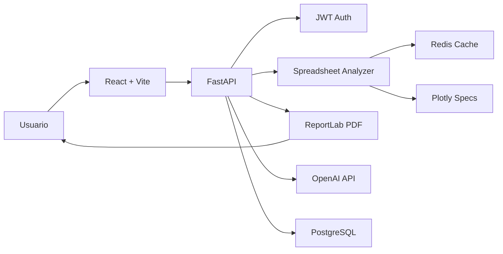

# SmartReports

SmartReports transforma planilhas Excel ou CSV em dashboards interativos e relatorios profissionais automaticamente. O projeto esta preparado como base comercial para SaaS multiempresa ou versao customizada.

**Acessar agora:** [abrir SmartReports Web Demo](https://smartreports-joaomdm31.joao31.chatgpt.site)

## Funcionalidades

- Login e cadastro com JWT.
- Upload seguro de `.xlsx`, `.xlsm`, `.xls` e `.csv`.
- Deteccao automatica de colunas numericas, datas, categorias, texto e booleanos.
- KPIs, graficos Plotly e perfil de qualidade dos dados.
- Resumo automatico e insights de negocio gerados a partir da planilha.
- Smart Analyst com resumo executivo, descobertas, riscos, oportunidades, recomendacoes e plano de acao.
- Copilot IA contextual para perguntar sobre o relatorio em linguagem natural, com integracao OpenAI API no backend.
- Logs estruturados, request id, compressao HTTP e rate limiting basico.
- Historico de relatorios por usuario.
- Exportacao de PDF profissional com ReportLab.
- Tema claro e escuro, layout responsivo e experiencia pensada para uso diario.
- PostgreSQL, Redis, FastAPI, React, Docker e Docker Compose.

## Link web sem servidor local

O frontend tambem roda em modo demo para publicacao estatica. Acesse em [https://smartreports-joaomdm31.joao31.chatgpt.site](https://smartreports-joaomdm31.joao31.chatgpt.site). O link abre direto na tela de login e permite testar cadastro, upload, dashboards, historico, chat e PDF usando armazenamento do navegador. Para ligar no SaaS real, configure `VITE_API_URL` com a API publica e `VITE_DEMO_MODE=false`.

## IA real com OpenAI API

O chat com IA chama a OpenAI pelo backend FastAPI. A chave nunca deve ficar no React.

No arquivo `.env`, configure:

```env
OPENAI_API_KEY=sk-proj-sua-chave
OPENAI_MODEL=gpt-5.6
OPENAI_REASONING_EFFORT=low
```

Sem `OPENAI_API_KEY`, o sistema continua funcionando com o Smart Analyst local como fallback. Para reduzir custo em alto volume, troque `OPENAI_MODEL` para um modelo mais economico disponivel na sua conta.

## Arquitetura



Detalhes completos em [docs/architecture.md](docs/architecture.md).

## Execucao com Docker

```bash
docker compose up --build
```

- Frontend: `http://localhost:5173`
- Backend: `http://localhost:8000`
- Swagger: `http://localhost:8000/api/docs`

Antes de vender ou publicar, altere `JWT_SECRET_KEY` e credenciais do PostgreSQL no `docker-compose.yml` ou em um arquivo `.env`.

## Desenvolvimento local

Backend:

```bash
cd backend
python -m venv .venv
.venv\Scripts\activate
pip install -r requirements.txt
uvicorn app.main:app --reload
```

Frontend:

```bash
cd frontend
npm install
npm run dev
```

Se preferir pnpm:

```bash
cd frontend
pnpm install
pnpm dev
```

Por padrao, o backend usa SQLite local quando `DATABASE_URL` nao e informado. Em producao, use PostgreSQL.

## Testes

```bash
cd backend
pytest
```

## Endpoints principais

- `POST /api/auth/register`
- `POST /api/auth/login`
- `GET /api/auth/me`
- `POST /api/reports/upload`
- `GET /api/reports`
- `GET /api/reports/{id}`
- `PATCH /api/reports/{id}`
- `POST /api/reports/{id}/chat`
- `GET /api/reports/{id}/pdf`
- `GET /api/dashboard/summary`

## Documentacao

- [Deploy](docs/deploy.md)
- [Publicacao no GitHub e acesso pela web](docs/github-web-deploy.md)
- [Arquitetura](docs/architecture.md)
- [Auditoria tecnica](docs/audit.md)
- [Plano de evolucao](docs/evolution-plan.md)
