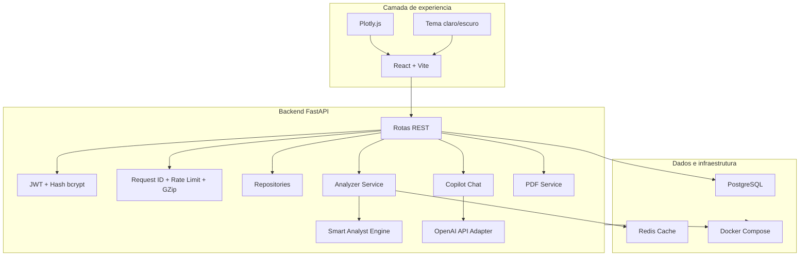
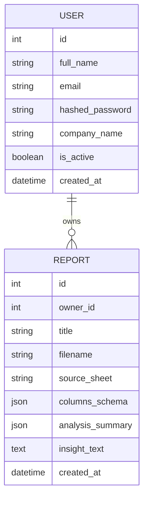

# Arquitetura do SmartReports

## Visao geral

O SmartReports usa uma arquitetura modular com frontend separado do backend. O backend concentra seguranca, persistencia, analise de planilhas, cache e geracao de PDF. O frontend consome contratos REST e renderiza dashboards interativos com Plotly.

## Backend

- `app/main.py`: cria a aplicacao, CORS e rotas.
- `app/core`: configuracao, banco, cache e seguranca.
- `app/core/middleware.py`: request id, headers de seguranca e rate limiting em memoria.
- `app/core/logging.py`: logs estruturados em JSON com request id.
- `app/models`: modelos SQLAlchemy.
- `app/repositories`: encapsula persistencia dos relatorios.
- `app/schemas`: contratos Pydantic.
- `app/api/routes`: endpoints de autenticacao, relatorios, dashboard e saude.
- `app/services/spreadsheet_analyzer.py`: leitura de arquivos, inferencia de tipos, KPIs, graficos e insights.
- `app/services/analyst.py`: raciocinio analitico local do Smart Analyst e fallback contextual.
- `app/services/ai_chat.py`: integra o Chat com IA a OpenAI API usando contexto compacto do relatorio.
- `app/services/pdf_service.py`: geracao do PDF executivo.

## Frontend

- `src/App.jsx`: estado global de sessao, tema e dados carregados.
- `src/pages/Dashboard.jsx`: orquestra a experiencia principal.
- `src/components`: upload, historico, KPIs, graficos, perfil de colunas e autenticacao.
- `src/components/SmartAnalystPanel.jsx`: leitura executiva estruturada da IA.
- `src/components/CopilotChat.jsx`: chat contextual sobre o relatorio selecionado.
- `src/services/api.js`: cliente REST.
- `src/styles/app.css`: design system leve com tokens de tema.

## Modelo de dados

## Decisoes de produto

- A primeira tela apos login ja e o ambiente operacional, com upload e leitura dos resultados.
- A analise e automatica, mas os objetos retornados sao estruturados para permitir edicao futura de graficos e templates.
- O Chat com IA usa OpenAI API quando `OPENAI_API_KEY` esta configurada e cai para o Smart Analyst local quando a chave estiver ausente ou a API estiver indisponivel.
- O cache Redis usa hash do arquivo para evitar reprocessamento de planilhas repetidas.
- O SQLite local reduz atrito no desenvolvimento, enquanto o Docker Compose entrega PostgreSQL para a pilha comercial.
